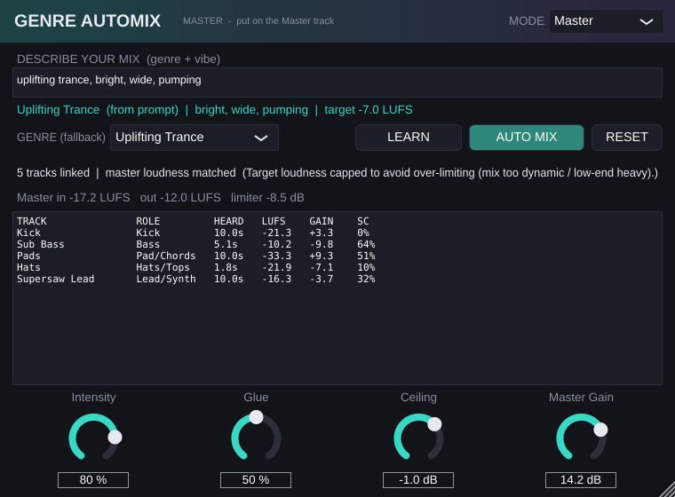

# Genre AutoMix

A JUCE plugin (VST3 / AU) that mixes a whole project automatically. You type the genre and the vibe, and it sets level, EQ, compression, tempo-synced sidechain, stereo width and master loudness on every track.



## How it works

You use one plugin in two modes:

| Mode | Where | What it does |
|---|---|---|
| **Track** | every channel (or group bus) | Measures its own audio (K-weighted loudness, 4-band spectrum, crest factor) and runs the mix chain: Trim → HPF → Low shelf → Mid bell → High shelf → Compressor → Makeup → Sidechain → Width |
| **Master** | Master track (one only) | Takes your prompt, sees all the Track instances, gives each one a role, computes and pushes their settings, then runs glue comp + look-ahead limiter and matches the target LUFS for the genre |

All instances share a registry inside the DAW process, so they talk to each other without any routing.

## Workflow in Ableton

1. Put **Genre AutoMix** on every track. Leave Mode = `Track`.
2. Put one more instance on the **Master** and set Mode = `Master`.
3. Type a prompt, for example:
   - `uplifting trance, bright, wide, pumping`
   - `dark techno, loud, punchy`
   - `deep house, warm, vocal forward`
   - `dnb clean dynamic`
4. Press **LEARN** and play the song through the breakdown *and* the drop (20–60 s is enough).
5. Press **AUTO MIX** (or hit Enter in the prompt box).
6. Keep playing for about 12 s. The master gain auto-matches the genre's loudness target.

Every setting is a normal automatable parameter that gets saved with your set. Open any track to tweak it, use **Bypass AutoMix** to A/B, and press **RESET** to go back to neutral.

## Genres

Uplifting Trance, Trance, Psytrance, Techno, House, Deep House, Progressive House, Drum & Bass, Dubstep, Hip-Hop, Pop, Lo-Fi, Ambient / Chill.

Each genre profile defines:
- relative level per role (kick is the reference)
- master LUFS target
- sidechain depth and release
- compression amount
- low and high tilt
- stereo width

These live in `Source/GenreProfiles.h`, so you can add genres or tune them there.

**Prompt modifiers:** `loud/club`, `dynamic/streaming`, `punchy`, `warm`, `bright/airy`, `dark`, `wide/epic`, `tight/mono`, `pumping/sidechain`, `no sidechain`, `vocal`, `bass heavy`, `clean`, `glue`.

## Role detection

The **track name** comes first. Ableton passes it to VST3, so names like "Kick", "Sub Bass", "Pads", "Hats", "Supersaw Lead", "Vox" and "FX Riser" all work. If the name doesn't match, the plugin falls back to **audio features** (low/high energy ratio and crest factor). You can always override the role with the ROLE dropdown on the track.

## Build

```bash
git clone <this repo> && cd GenreAutoMix
cmake -B build -DCMAKE_BUILD_TYPE=Release          # JUCE 8 is fetched automatically
cmake --build build --config Release
```

**macOS:** the output is in `build/GenreAutoMix_artefacts/Release/{VST3,AU}`. Copy it to `~/Library/Audio/Plug-Ins/VST3` (or `.../Components` for AU).

**Windows:** copy the `.vst3` to `C:\Program Files\Common Files\VST3`.

If you push to GitHub, `.github/workflows/build.yml` builds for Mac and Windows automatically.

**Headless test:** run `cmake -B build -DGAM_TESTS=ON && cmake --build build && ./build/GamTest_artefacts/Release/GamTest`. It runs 5 synthetic tracks plus the master through Learn → Auto Mix → loudness match.

## Limitations

- All instances must run in the **same process**. That's fine for Ableton, Logic, FL and Cubase. In Bitwig, turn plugin sandboxing to "Within Bitwig".
- The sidechain is **tempo-synced from the host playhead** (LFOTool style). It's sample-accurate and has no routing, but it assumes a four-on-the-floor kick. Genres that aren't four-on-the-floor have the sidechain off unless your prompt asks for it.
- The plugin gets you a solid starting mix. It doesn't do creative mixing. Expect to fine-tune the lead/vocal level and the sends by ear.
- Learning only counts audio above the -50 LUFS gate, so a track has to actually play during LEARN or it gets skipped.
